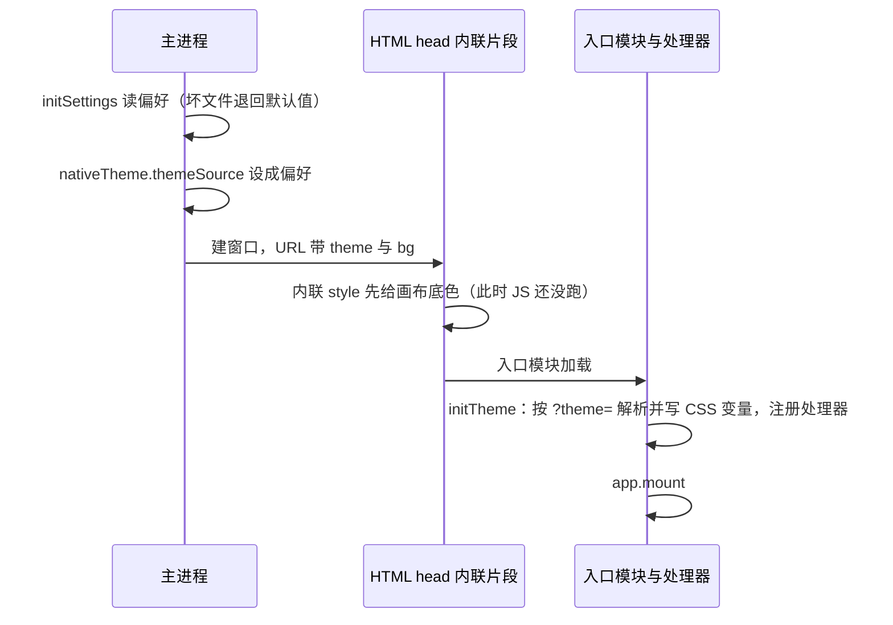
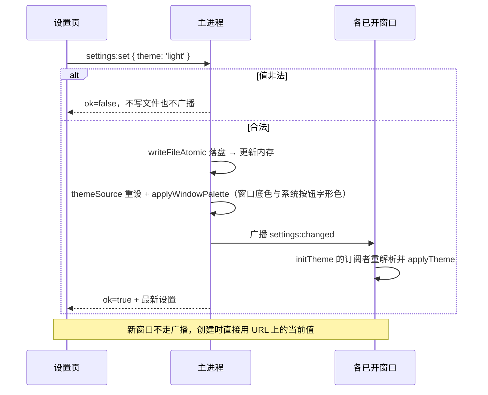

# 颜色主题

**状态**：现行架构
**最后更新**：2026-10-08

**关联**：[settings-page.md](../roadmap/settings-page.md)（偏好的落点）、[icon-library.md](./icon-library.md)（图标跟令牌变色）

---

## 1. 背景

1. **原来只有深色一套。** 组件里的字面色值已收进令牌，但值全集中在 `src/renderer/styles/theme.css`：
   65 个 `--app-*` 令牌 + 要覆盖的 `--el-*` 色阶，共 **122 条颜色声明**，只有这一套。
2. **主进程那份是第二份真源。** `window-manager` 里曾有一张与 `theme.css` 同值的 `WINDOW_COLORS` 表，
   靠注释维持一致——主题化要消灭的正是它（已删）。
3. **首帧颜色由主进程带进渲染进程。** 内联片段按窗口 URL 上的 `?bg=` 设 `--win-bg`。主题不能在挂载后才决定，
   否则先闪一下错误底色。
4. **窗口那一层也归主进程。** `BrowserWindow` 的 `backgroundColor` 与 Windows / Linux 的
   `titleBarOverlay.symbolColor` 在 `create()` 里给，渲染进程改不了。
5. **四个入口各有独立样式。** 查看器与浮窗不引 Element Plus，主题必须在每个入口都生效。
6. **尺寸也没有系统。** `theme.css` 之外还有 **363 个尺寸字面量**（`height` 74、`padding` 71、`font-size` 56、
   `width` 53、`gap` 30、`border-radius` 23）。

### 1.1 修改历史

| 日期 | 变更 | 原因 |
|---|---|---|
| 2026-09-29 | 首次记录（需求登记） | 使用者提出 |
| 2026-10-05 | 评审：定为**一份主题对象 + 一组注册的处理器**——值放 `src/common/theme/`（两个进程都 import），Element 侧的处理器把它写成 CSS 变量、Monaco 的处理器设自己的主题；主进程只当「选择」的真源并管窗口那一层 | 对照 dsh 的 `ui-theme`，并纠正「值只放 CSS」会逼 JS 消费者去 DOM 里刮字符串 |
| 2026-10-05 | 收编落地：值搬进 `src/common/theme/`、主题管理器与注册处理器、删掉主进程的镜像、补尺寸阶梯、加样式表扫描用例（`a577344`、`9d9a8c0` 等） | 先把不依赖设置页与切换的部分做完 |
| 2026-10-07 | 切换入口与持久化落地：偏好进 `settings.yml`、建窗口时经 URL 的 `?theme=` 首帧送达、改完广播 `settings:changed`；文档迁入 `docs/design/` | 方案最后一块完成 |
| 2026-10-08 | 脚本编辑器的 `monaco.rules` 由词元名改成 TextMate 作用域 | 词法器换成 TextMate（见 [monaco-textmate.md](./monaco-textmate.md)），注释能分行内 / 行间两级 |

---

## 2. 值的唯一来源：一份主题对象

`src/common/theme/`（`index.ts` 出统一入口），**一套主题一个文件**，加一套主题 = 照抄一份改值：

    THEMES.dark = {
      tokens: {                       // 既含颜色也含尺寸，键就是 CSS 变量名
        '--app-bg-page': '#191a1c', '--app-text-regular': '#dfe1e5', …
        '--app-space-8': '8px', '--app-radius-4': '4px', '--app-font-base': '13px', …
      },
      monaco: {
        base: 'vs-dark',              // token 着色的底
        rules: [{ … }],               // 语法规则：按 TextMate 作用域着色，色值取自 Dark.icls / Light.icls
        colors: { 'editor.background': …, 行号、选中、当前行、差异色 },
      },
    }

两套主题的键必须一致，两处各拦一半：**键名写错**是编译错误（第二套声明成 `Theme<typeof darkTokens>`，
键被约束在第一套的键集合上），**漏掉一个键**编译期看不出来（`tokens` 是 `Partial`），由
`test/scripts/stylesheet-tokens.test.ts` 断言两套的 `--app-*` 键集合相等。两个进程 import 同一份对象，
所以跨进程只传**选择**：

    { preference: 'dark' | 'light' | 'system',   // settings.yml 里的偏好
      resolved:   'dark' | 'light' }             // 主进程解析后的结果；处理器拿 THEMES[resolved]

**`resolved` 只由主进程算一次**（`preference === 'system' ? (nativeTheme.shouldUseDarkColors ? 'dark' : 'light') : preference`）。
渲染进程自己解析也不会错位：非 `system` 的偏好根本不看系统明暗。

## 3. 选择的真源与送达

- 偏好是 `settings.yml` 的一个键（缺省 `system`），校验在 `src/common/settings.ts`，读写与广播在 `src/main/settings/`。
- **主进程是「选择」的唯一真源**：启动时（建任何窗口之前）读进内存 → 内存态决定 `nativeTheme.themeSource`。
- **送达分两条路**：
  1. **新窗口**：建窗口时把偏好写进 URL（`?theme=`），渲染进程在首帧之前就有值；
  2. **已开窗口**：改完偏好广播 `settings:changed`（载荷是整份设置），四个入口都会收到并重解析。
- **渲染进程不放缓存**（localStorage 之类）：值的送达不是异步的，缓存只会补一个并不存在的延迟，
  并引入第二份会过期的状态。

### 3.1 启动顺序

**为什么画布底色要单独提前**：外链 CSS 与模块脚本都晚于首次绘制，而「值的唯一来源是对象」这件事在 JS 跑起来之前
无法兑现——所以主进程把**一个底色**经 URL 内联过去。这是唯一一处提前，不是第二份调色板。

### 3.2 切换流程

界面侧**不做乐观更新**：`ok: false` 时提示并保持原样，避免「界面换了、窗口没换」。

## 4. 主题管理器与处理器

`src/renderer/entries/shell/theme.ts`，四个入口共用；它同时是 `settings:changed` 的订阅点。

    applyTheme(theme)        记下当前主题，先把 theme.tokens 逐项写进 :root，再依次调用所有 handler
    onThemeChange(handler)   注册（注册时立刻用当前主题调一次），返回注销函数

三条约束：

- **handler 之间互不依赖，所以不需要约定顺序**：它们从主题对象取值，不从 DOM 里读。
- **注销要真的调**：编辑器页会挂载 / 卸载，不注销就会在切换时调用已卸载组件的 handler。
- **处理器只做「把新值落到自己这边」**：不在这里做业务判断。

| 注册者 | 收到通知后做什么 |
|---|---|
| 应用本体（Element Plus 与页面，含尺寸） | **不是单独注册的**：管理器自己就把 `theme.tokens` 逐项写进 `:root`，再通知其余处理器——组件库的颜色全走 CSS 变量，变量一改它就跟着变 |
| Monaco（`monaco-env.ts`） | `defineTheme('plmanager', theme.monaco)` + `setTheme('plmanager')`，**含按作用域配置的语法着色**（`rules`）与编辑器配色 |

**Element Plus 本身没有「主题 API」**：它的颜色全走 CSS 变量，所以「注册一个处理器」在这里的含义就是
「把变量写对」——写完之后组件与页面一起变。

## 5. 主进程这一层

- 窗口底色与系统按钮字形色取 `THEMES[resolved].tokens`（`window-manager` 的 `palette()`）；`WINDOW_COLORS` 与两态表已删。
- **原生按钮分两种**：Windows / Linux 的 WCO 是显式的——`setTitleBarOverlay({ color, symbolColor })` 逐个窗口调；
  **macOS 的红绿灯不能逐个设色**，它跟随 `NSAppearance`，由 `nativeTheme.themeSource` 决定。
- `themeSource` 还不只是为红绿灯：它同时决定渲染进程里 `prefers-color-scheme` 的结果——不设的话，
  走媒体查询的样式会跟系统而不是跟应用。
- **不要设成 `resolved`**：偏好是 `system` 时会把它钉死成当时的取值、不再跟随系统。规则是 `themeSource` = 偏好，
  `resolved` 由 `shouldUseDarkColors` 派生。
- `applyWindowPalette()` 有**两条触发路径**：系统的 `nativeTheme` `updated`，以及设置改动（`settings/ipc` 显式调）。
  后者不能省：系统亮色下把偏好从「深色」改成「浅色」时，系统明暗压根没变，等不到 `updated`。

## 6. 尺寸

- 与颜色进同一份 `tokens`（键 `--app-space-*` / `--app-radius-*` / `--app-font-*`），
  由同一个处理器写下去——「统一」贯彻到底。结构尺寸（如 `--title-bar-height`）不在这里：它与主进程的
  窗口配置成对，写在 `App.vue` 的 `:root` 里。
- **口径**：只有「同一条尺度轴上还能再取值」的才建令牌——重复出现或跨组件共享的（`12px` 49 处、`8px` 34 处、
  `4px` 32 处、`16px` 32 处）；一次性的对齐值（`1px` 边框、`2px` 偏移、某个卡片自己的宽）留字面量。

## 7. 失败与边界

| 情形 | 行为 |
|---|---|
| `settings.yml` 坏 / 缺 `theme` / 值非法 | 退回 `system`（`DEFAULT_THEME`）+ 一条 error 日志；启动不受影响 |
| 窗口 URL 上的 `theme` 丢了 | 按 `system` 兜底并记一条 warn（只可能是有人直接打开了那个 HTML） |
| 某套主题少一个键 | 编译期看不出来（`tokens` 是 `Partial`），由键集合断言的用例拦（§8） |
| 处理器抛异常 | 逐个 try/catch 并记日志，一个处理器失败不影响其余与启动 |
| 写设置文件失败 | 返回 `ok: false`，不广播、不改窗口、内存也不动 |

## 8. 强制：样式表扫描用例

`test/scripts/stylesheet-tokens.test.ts` 扫 `src/**/*.{ts,vue,css}`：颜色只准以 `var(--app-*)` / `var(--el-*)` 出现
（`#hex`、`rgb()` 一律失败）。**色值的唯一合法落点是 `src/common/theme/`**，例外只有 `first-paint.ts` 的内联片段
（它要早于外链 CSS 生效，那时变量还不存在）。注释里的色值不算——说明文字里引用具体颜色是正常的。

## 9. 改动时的检查点

- **加一套主题**：只加一个 `src/common/theme/<名>.ts` 并登记进 `THEMES`；组件、处理器、主进程都不动。
  键少一个会在 `vue-tsc` / `tsc` 与扫描用例两处同时报。
- **新增一个窗口入口**：必须调 `initWindowChrome()`（它内部调 `initTheme`），否则那个窗口不换主题。
- **改主进程的窗口配色**：两条路径（建窗口、`applyWindowPalette`）都要照顾到；`titleBar.height` 与
  `.title-bar` 的 `--title-bar-height` 必须相等。
- **要在渲染进程读某个令牌的值**：不要从 DOM 里 `getComputedStyle` 刮，直接从主题对象取——那正是把值
  放 `src/common/theme/` 换来的好处。
- **新增尺寸**：先判断它是「尺度轴上的一个值」还是一次性对齐值（见第 6 节的口径），别把令牌表撑大。
- **改语法着色规则**：脚本编辑器的分词器是 TextMate，规则键是作用域；通用词元名规则留着给其它语言与语义高亮用，删了会同时丢掉降级色。
- 验证：`yarn test` 里的扫描用例管颜色与键集合；其余靠人工——四个窗口各看一遍（主窗口、查看器、浮窗、各类弹窗），
  深色与浅色各一次，Windows / Linux 还要看系统按钮字形色。

## 10. 已知取舍

| 取舍 | 代价 |
|---|---|
| 值的唯一来源是 JS 对象，而不是纯 CSS | 首帧那一下只能由主进程经 URL 带一个底色（唯一一处提前，见 §3.1） |
| 全仓禁用字面色值 | 一次性的对齐值也要逐个判断是否建令牌 |
| 偏好只存主进程、渲染进程不缓存 | 新增窗口必须由主进程带上 `?theme=`，漏了会先闪系统主题 |
| 切换走广播 + 每个入口自己解析 | 每个入口都要注册处理器并订阅广播 |

**已知未跟**：脚本页的改动色条（新增 / 修改 / 删除三色）是建编辑器时取的，切换主题后要重新打开脚本页才刷新。

**编辑器的词法层**：脚本编辑器换成了 TextMate 词法器（`src/renderer/views/main/scripts/textmate/`），主题规则按
**作用域**配置，`comment.line` 与 `comment.block` 因此能分开着色；其余语言仍用 Monaco 内置分词器，靠同一张表里
保留的通用词元名规则着色。色值按 WebStorm 导出的配色方案逐作用域对齐（暗色 Islands Dark、浅色 Light），映射见 [monaco-textmate.md](./monaco-textmate.md)。
